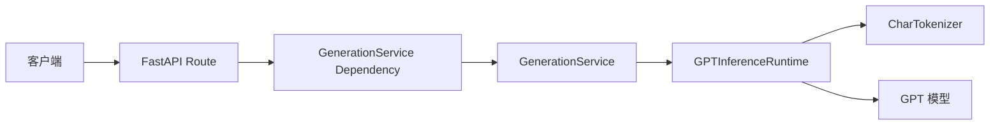
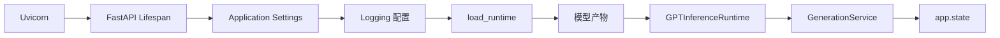

# Mini GPT Service

## 项目概述

Mini GPT Service 将一个自定义的字符级 GPT 模型封装为 FastAPI 同步推理服务。GPT 模型在独立训练项目中实现和训练，训练结果被导出为可移植模型产物（portable model artifact），本项目只负责加载产物并对外提供文本生成能力。

服务代码与模型产物有意分离：应用镜像不绑定具体权重，同一套服务代码可以通过配置加载不同版本的兼容产物。

## 主要特性

- FastAPI 同步文本生成 API
- 通过 Application Lifespan 在启动阶段一次性加载模型
- 可复用的应用级 `GPTInferenceRuntime`
- Route、Service、Runtime、Tokenizer 分层
- FastAPI Dependency Injection
- 由 `model.pt`、`config.json`、`tokenizer.json` 组成的可移植模型产物
- 领域异常与 HTTP 错误映射
- 基于 `pydantic-settings` 的集中应用配置
- 基于 Python 标准库的集中日志配置
- 生成文本、生成长度和推理耗时观测信息
- CPU-only Docker 运行支持
- 单元测试与 API 集成测试

## 架构

### 请求调用链



Route 只处理请求和响应映射；Service 负责生成级业务逻辑、耗时统计和业务日志；Runtime 负责文本、Token Tensor、设备和模型之间的协调；Tokenizer 与 GPT 不依赖 FastAPI。

### 应用启动生命周期



模型只在应用启动阶段加载一次。加载失败会阻止应用启动，不会被静默忽略，也不会在每次请求中重复加载模型。

## 项目结构

```text
mini-gpt-service/
├── app/
│   ├── api/
│   │   ├── routes/                 # /health 与 /generate 路由
│   │   ├── schemas/                # Pydantic 请求和响应模型
│   │   ├── dependencies.py         # GenerationService 依赖
│   │   └── exception_handlers.py   # 领域异常到 HTTP 的映射
│   ├── core/
│   │   ├── config.py               # Application Settings
│   │   ├── exceptions.py           # 领域异常
│   │   ├── lifespan.py             # 启动资源生命周期
│   │   └── logging.py              # 集中日志配置
│   ├── model/
│   │   ├── gpt.py                  # GPT 模型
│   │   ├── block.py                # GPT Block
│   │   ├── embedding.py            # Token 与位置 Embedding
│   │   ├── attention.py            # 单头因果注意力
│   │   ├── multi_head_attention.py # 多头因果注意力
│   │   ├── feed_forward.py         # Feed Forward
│   │   ├── tokenizer.py            # 字符级 Tokenizer
│   │   ├── loader.py               # 模型产物加载
│   │   └── runtime.py              # 应用级推理 Runtime
│   ├── services/
│   │   ├── generation_service.py   # 文本生成业务逻辑
│   │   └── generation_result.py    # 生成业务结果对象
│   └── main.py                     # FastAPI 应用组装
├── tests/
│   ├── unit/                       # 单元测试
│   └── integration/                # API 集成测试
├── configs/                        # 配置文件预留目录
├── model-artifacts/                # 本地模型产物，不进入 Docker 镜像
├── .dockerignore
├── .env.example
├── Dockerfile
├── pyproject.toml
└── requirements-cpu.txt            # Docker CPU 直接依赖
```

## 模型产物

服务期望一个包含以下文件的目录：

```text
model-artifacts/char-gpt-v1/
├── model.pt       # 模型 state_dict
├── config.json    # GPT 架构参数
└── tokenizer.json # 训练阶段字符词表
```

`config.json` 管理 `vocab_size`、`block_size`、`embedding_dim`、层数、注意力头数和 dropout 等模型架构参数。这些参数属于模型产物，不属于应用运行配置。

加载权重时始终先使用 `map_location="cpu"`，随后再由 Runtime 选择的设备运行。这保证了产物可以从训练环境迁移到 CPU 服务环境。

## 本地安装

项目要求 Python 3.10 或更高版本。

```bash
python -m venv .venv
source .venv/bin/activate
python -m pip install --upgrade pip
python -m pip install -e ".[dev]"
```

运行测试：

```bash
pytest -q
```

运行静态检查：

```bash
ruff check app tests
```

## 本地运行

确保模型产物位于默认目录，或通过环境变量指定产物路径：

```bash
export MINI_GPT_MODEL_ARTIFACT_PATH=model-artifacts/char-gpt-v1
export MINI_GPT_LOG_LEVEL=INFO
uvicorn app.main:app --reload
```

应用支持的环境变量：

| 环境变量 | 默认值 | 用途 |
| --- | --- | --- |
| `MINI_GPT_MODEL_ARTIFACT_PATH` | `model-artifacts/char-gpt-v1` | 模型产物目录 |
| `MINI_GPT_LOG_LEVEL` | `INFO` | 应用日志级别 |

也可以复制示例配置：

```bash
cp .env.example .env
```

## API

服务启动后，Swagger UI 位于：<http://localhost:8000/docs>

### `GET /health`

返回基本服务状态：

```json
{
  "status": "ok"
}
```

### `POST /generate`

请求示例：

```bash
curl -X POST http://localhost:8000/generate \
  -H "Content-Type: application/json" \
  -d '{
    "prompt": "ROMEO:",
    "max_tokens": 20,
    "temperature": 0.8,
    "top_k": 40
  }'
```

请求字段：

| 字段 | 类型 | 说明 |
| --- | --- | --- |
| `prompt` | `string` | 非空字符级提示文本 |
| `max_tokens` | `integer` | 生成字符数，必须大于 0 |
| `temperature` | `number` | 采样温度，必须大于等于 0；`0` 表示贪心生成 |
| `top_k` | `integer \| null` | Top-K 采样限制；提供时必须大于 0 |

响应示例：

```json
{
  "text": "ROMEO:\nWhat shall I say...",
  "generated_tokens": 20,
  "latency_ms": 42.731
}
```

当前模型是字符级模型，因此 `generated_tokens` 暂时通过输出文本长度与 prompt 长度之差计算。

## 错误处理

应用区分以下错误：

- Pydantic 请求校验错误返回 HTTP `422`。
- 模型输入领域错误由低层模块抛出领域异常，再由 API 层映射为客户端错误。
- 未预期的内部异常不被统一转换为客户端错误，继续返回 HTTP `500`。

例如，字符级词表不包含输入字符时，`CharTokenizer` 会使用 exception chaining 将原始 `KeyError` 转换为 `UnknownCharacterError`。API 层只将该异常映射为 HTTP `400`：

```json
{
  "detail": "Unsupported character: '你'"
}
```

Tokenizer、Runtime 和 Service 均不导入 `HTTPException` 或 HTTP 状态码。

## CPU Docker 运行

Dockerfile 基于官方 `python:3.12-slim`，显式安装 CPU-only PyTorch。镜像不包含模型产物，也不需要 CUDA 或 NVIDIA Container Toolkit。

构建镜像：

```bash
docker build -t mini-gpt-service .
```

在项目根目录运行容器，并将宿主机模型目录只读挂载到 `/models`：

```bash
docker run --rm \
  --name mini-gpt-service \
  -p 8000:8000 \
  -v "$(pwd)/model-artifacts:/models:ro" \
  -e MINI_GPT_MODEL_ARTIFACT_PATH=/models/char-gpt-v1 \
  -e MINI_GPT_LOG_LEVEL=INFO \
  mini-gpt-service
```

容器内 Uvicorn 监听 `0.0.0.0:8000`，且不启用 `--reload`。Docker Healthcheck 使用 Python 标准库访问 `/health`，不额外安装 `curl`。

启动后可访问：

- <http://localhost:8000/health>
- <http://localhost:8000/docs>
- `POST http://localhost:8000/generate`

## 测试策略

- 单元测试覆盖 Tokenizer、模型加载、Runtime、Service、Schema、Settings 和 Logging。
- API 集成测试覆盖 `/health`、`/generate`、Pydantic 校验和领域异常映射。
- 测试通过 Dependency Override、Fake Runtime 和 Fake Service 隔离真实模型。
- 除专门的 artifact 加载测试外，API 测试不需要加载真实模型。
- 测试不使用固定的性能耗时上限，只验证 `latency_ms >= 0`。

## 工程设计决策

1. **启动时加载模型**：避免每次请求重复读取约重和构造模型，启动失败也能在接收流量前暴露。
2. **API / Service / Runtime 分层**：HTTP 映射、生成业务逻辑和模型交互各自独立，降低耦合并便于测试。
3. **依赖注入**：Route 只声明 `GenerationService`，测试可以替换为 Fake Service，不需要加载真实模型。
4. **可移植模型产物**：权重、架构配置和字符词表共同版本化，避免服务端重新推断训练参数。
5. **领域异常**：Tokenizer 抛出业务语义明确的异常，FastAPI 只存在于 API 映射层。
6. **集中应用配置**：所有已使用的部署配置通过 `Settings` 和统一环境变量前缀读取。
7. **模型产物与镜像分离**：镜像可复用，模型可以独立更新，并可通过只读挂载降低误修改风险。

## 当前限制

- 仅支持训练产物中的字符级词表。
- 推理接口为同步调用。
- 不支持请求批处理。
- Docker 镜像仅支持 CPU 推理。
- 不支持流式输出。
- 没有身份认证和授权。
- 没有限流、排队或超时控制。
- 每个应用进程会各自持有一份模型实例。

## 后续方向

- 流式文本生成
- 请求批处理
- GPU 容器部署
- BPE 或其他子词 Tokenizer
- Prometheus 指标与延迟分位数
- CI/CD
- 模型版本管理与兼容性校验
